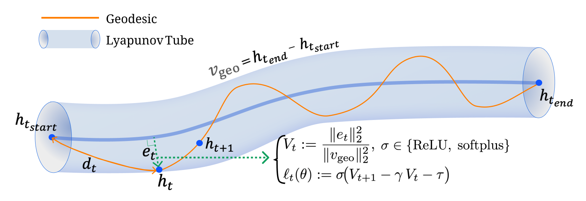
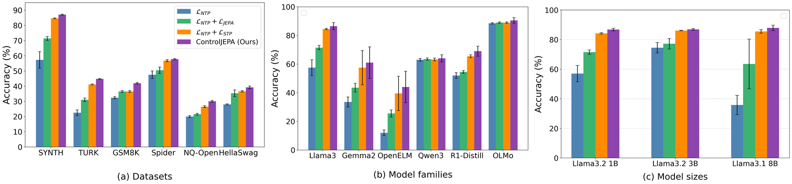

<div align="center">

# ControlJEPA: Principled Trajectory Regularization via Lyapunov Tube Loss

**Thai-Khanh Nguyen**<sup>1\*</sup> &nbsp;
**Nhi Y. Pham**<sup>2\*</sup> &nbsp;
**Uyen N.B. Vo**<sup>1\*</sup> &nbsp;
**Thieu N. Vo**<sup>3†</sup> &nbsp;
**Cuong Pham**<sup>1†</sup> &nbsp;
**Tan M. Nguyen**<sup>4†</sup>

<sup>1</sup>Posts & Telecommunications Institute of Technology &nbsp;
<sup>2</sup>VinUniversity &nbsp;
<sup>3</sup>University of Bath &nbsp;
<sup>4</sup>National University of Singapore

<sup>\*</sup>Equal contribution &nbsp; <sup>†</sup>Equal advising

**NeurIPS 2026**

[](https://neurips.cc/)
[](LICENSE)
[](https://www.python.org/)
[](https://pytorch.org/)

</div>

<p align="center">
  
</p>

<p align="center"><em>
The displacement d<sub>t</sub> = h<sub>t</sub> − h<sub>t<sub>start</sub></sub> splits into a component along the
reference secant v<sub>geo</sub> and a transversal error e<sub>t</sub> ⊥ v<sub>geo</sub>. The Lyapunov Tube
Loss penalises violations of V<sub>t+1</sub> ≤ γV<sub>t</sub> + τ, which keeps hidden-state trajectories inside the tube.
</em></p>

## TL;DR

Next-token prediction places almost no constraint on the path that hidden states take through a sequence. Earlier
geometric regularisers mostly control the *direction* of that path, not *how far* it strays. **ControlJEPA** adds a
single training loss, the **Lyapunov Tube Loss**, built on the discrete-time contraction condition from practical
Input-to-State Stability (ISS). The loss is applied to a scale-invariant measure of transversal deviation.

- **Tube guarantee.** When the contraction condition holds at every step, the trajectory stays inside an explicit tube
  around the reference secant.
- **Partial-ISS bounds.** When it holds only partly, the paper bounds the mean transversal energy, the temporal
  variance and the average tube width in terms of the loss value and (γ, τ).
- **No architecture changes and no inference cost.** The regulariser is used only during fine-tuning. The smoother
  transversal profile still holds at generation time, when the loss is switched off.
- **Results.** Across 6 benchmarks and 6 model families, ControlJEPA improves accuracy and data efficiency over
  standard fine-tuning, [LLM-JEPA](https://github.com/galilai-group/llm-jepa) and Semantic Tube Prediction (STP).

## Method

For a training example (the user turn followed by the assistant turn), let `h_t` be the final-layer hidden state at
token `t`. ControlJEPA decomposes the trajectory with respect to its reference secant, as in Eqs. (9)–(11):

$$
v_{\text{geo}} = h_{t_{\text{end}}} - h_{t_{\text{start}}},\qquad
d_t = h_t - h_{t_{\text{start}}},\qquad
e_t = \big(I - \hat v \hat v^{\top}\big)\, d_t,\qquad
V_t = \frac{\lVert e_t\rVert_2^2}{\lVert v_{\text{geo}}\rVert_2^2}.
$$

The Lyapunov candidate $V_t$ is dimensionless and is zero at both anchors. Practical ISS requires
$V_{t+1} \le \gamma V_t + \tau$ (Eq. 12). This gives $V_t \le \tau/(1-\gamma)$, i.e. a tube of radius
$r^\star = \sqrt{\tau/(1-\gamma)}\,\lVert v_{\text{geo}}\rVert_2$ (Eq. 16). The loss penalises violations of the
condition (Eqs. 17–19):

$$
\mathcal{L}_{\text{Lyap}} = \frac{1}{|\mathcal{T}|}\sum_{t\in\mathcal{T}} \sigma\!\big(V_{t+1} - \gamma V_t - \tau\big),
\qquad
\mathcal{L} = \mathcal{L}_{\text{NTP}} + \lambda\,\mathcal{L}_{\text{Lyap}},
\qquad \sigma\in\{\text{softplus}, \text{ReLU}\}.
$$

### From equations to code

| Paper | Code |
| --- | --- |
| Secant, displacement and transversal error, Eqs. (9)–(10) | [`lyapunov_loss.chord_decomposition`](lyapunov_loss.py) |
| Dimensionless Lyapunov candidate $V_t$, Eq. (11) | [`LyapunovTubeLoss.lyapunov_candidate`](lyapunov_loss.py) |
| Violation penalty and Lyapunov Tube Loss, Eqs. (17)–(18) | [`LyapunovTubeLoss.forward`](lyapunov_loss.py) |
| Training objective $\mathcal{L}_{\text{NTP}} + \lambda\mathcal{L}_{\text{Lyap}}$, Eq. (19) | `RepresentationTrainer.compute_loss` in [`stp.py`](stp.py) |
| Ablations $\lVert e_t\rVert^2/D$ and $\lVert e_t\rVert^2/\lVert d_t\rVert^2$, Sec. 6.2 | `--control_norm d_model` / `--control_norm d_t` |

**Implementation note: the chord.** In a chat-formatted example, the user content and the assistant content are
separated by prompt-template tokens (for example `<|eot_id|><|start_header_id|>assistant<|end_header_id|>`). The
trajectory is the user span `[u_s, u_e]` followed by the assistant span `[a_s, a_e]`, and the template tokens are
skipped:

```text
v_user = h[u_e] - h[u_s]
v_geo  = v_user + (h[a_e] - h[a_s])
d_t    = h[t] - h[u_s]                for t in [u_s, u_e]
d_t    = v_user + (h[t] - h[a_s])     for t in [a_s, a_e]
```

The set of transitions $\mathcal{T}$ contains only the transitions *inside* each span. The jump across the template is
never penalised.

```python
from lyapunov_loss import LyapunovTubeLoss

loss_fn = LyapunovTubeLoss(gamma=0.95, tau=1e-4)                # softplus penalty, V_t = ||e_t||^2 / ||v_geo||^2
lyap = loss_fn(hidden_states, user_bounds, assistant_bounds)   # (B, T, D); inclusive (start, end) per example
loss = lm_loss + 0.05 * lyap
```

## Results

<p align="center">
  
</p>

<p align="center"><em>
Accuracy (mean ± std over 5 seeds) of NTP, LLM-JEPA, STP and ControlJEPA across (a) benchmarks,
(b) model families and (c) model sizes (Fig. 3 of the paper).
</em></p>

ControlJEPA gains the most on GSM8K and NQ-Open, about +10 points over NTP. The paper also reports:

- the Lyapunov loss is stable for λ ∈ [0.01, 0.08];
- ControlJEPA matches full-data NTP using only a fraction of the training data;
- it has a higher median signal-to-noise ratio (Eq. 30) than NTP and STP on open-loop generations.

The ablations show that both design choices matter:

- **Normalisation of V<sub>t</sub>.** Removing it causes scale collapse, and accuracy drops to 6.3%.
- **Contraction rate.** A strict γ = 0.8 gives 28.7%, compared with 86.78% at γ = 0.95.

## Repository structure

```text
ControlJEPA/
├── lyapunov_loss.py     # Lyapunov Tube Loss (self-contained, depends only on PyTorch)
├── reachability_loss.py # Experimental Lyapunov-Reachability loss (reach_JEPA, not in the paper)
├── stp.py               # Training: NTP (--regular), STP (--linear=random_span), ControlJEPA (--linear=control_JEPA)
├── finetune.py          # LLM-JEPA baseline (unchanged from the official implementation)
├── evaluate.py          # Generation-based evaluation, shared by all methods
├── scripts/
│   ├── common.sh        # Per-model / per-benchmark settings, train() and evaluate() helpers
│   ├── run.sh           # Main results: methods x models x benchmarks x 5 seeds
│   └── sweep.sh         # (lambda, gamma, tau) sweep, normalisation ablation, data efficiency
├── datasets/            # Train/test splits in OpenAI-message JSONL format
├── tests/               # Unit tests for the loss and the evaluation metrics
└── assets/              # Figures for this README
```

## Installation

```bash
git clone https://github.com/t-khanusa/ControlJEPA.git
cd ControlJEPA
conda create -n controljepa python=3.10 -y
conda activate controljepa
pip install torch --index-url https://download.pytorch.org/whl/cu126   # pick the build for your CUDA version
pip install -r requirements.txt
```

The Llama and Gemma checkpoints are gated on the Hugging Face Hub. Accept their licences, then run
`huggingface-cli login`.

### Data

The NL-RX-SYNTH, NL-RX-TURK, GSM8K, Spider, NQ-Open and HellaSwag splits are in [`datasets/`](datasets), in the same
format as LLM-JEPA and STP. `datasets/synth_train_frac1_{2,4,8,16,32}.jsonl` are the subsampled training sets used for
the data-efficiency study (Sec. 5.3).

Spider is evaluated by *execution accuracy*, which needs the Spider SQLite databases. Download them from the
[official Spider page](https://yale-lily.github.io/spider), or take `spider_data.zip` from the
[LLM-JEPA repository](https://github.com/galilai-group/llm-jepa). Unzip so that this file exists:

```text
spider_data/database/<db_id>/<db_id>.sqlite
```

## Quick start

To train ControlJEPA on NL-RX-SYNTH with Llama-3.2-1B-Instruct on 2 GPUs and then evaluate it:

```bash
torchrun --nproc_per_node=2 stp.py \
  --train_file=datasets/synth_train.jsonl --output_dir=checkpoints/controljepa-synth \
  --model_name=meta-llama/Llama-3.2-1B-Instruct --finetune_seed=82 \
  --num_epochs=4 --learning_rate=2e-5 --batch_size=2 --grad_accum=4 \
  --linear=control_JEPA --last_token=-2 --predictors=0 \
  --lbd=0.05 --tube_gamma=0.95 --tube_tau=1e-4 \
  --supervise_eos --eos_ce_weight=2   # stop-decision supervision, active on SYNTH/TURK only (see below)

python evaluate.py \
  --model_name=checkpoints/controljepa-synth --original_model_name=meta-llama/Llama-3.2-1B-Instruct \
  --input_file=datasets/synth_test.jsonl --output_file=checkpoints/controljepa-synth/eval.jsonl \
  --split_tune_untune --nosplit_data --max_new_tokens=96
```

The ControlJEPA-specific flags are:

| Flag | Default | Meaning |
| --- | --- | --- |
| `--linear=control_JEPA` | | Turn on the Lyapunov Tube Loss |
| `--lbd` | `0.1` (scripts use `0.05`) | Loss weight λ |
| `--tube_gamma` | `0.95` | Contraction rate γ ∈ (0, 1) |
| `--tube_tau` | `1e-4` | ISS slack τ ≥ 0 |
| `--control_norm` | `v_geo` | Normalisation of $V_t$: `v_geo` (the method), or the `d_model` / `d_t` ablations |
| `--anchor_eps` | `1e-3` | Smoothing of the `d_t` denominator near the anchors (used only by the ablation) |
| `--random_span_layer` | `-1` | Decoder layer whose hidden states form the trajectory |
| `--lbd_control` | unset | Overrides `--lbd` for `control_JEPA` |
| `--tube_log_interval` | `50` | Print a one-line diagnostics summary every N steps (`0` = off) |
| `--supervise_eos`, `--eos_ce_weight` | off, `0` | Stop-decision supervision, see [below](#stop-decision-supervision-synth-and-turk) |

## Reproducing the paper

All methods share one codebase, the same splits, the same decoding and the same validation rules. Each configuration is
run with the 5 seeds `82 23 37 84 4`. The scripts default to 2 GPUs (`NPROC_PER_NODE=2`).

**Main results (Fig. 3).** These are NTP, LLM-JEPA, STP and ControlJEPA across datasets, model families and model
sizes:

```bash
# All benchmarks, Llama-3.2-1B-Instruct, 5 seeds, all four methods
METHODS="regular llm_jepa stp controljepa" bash scripts/run.sh

# Model families and sizes
MODELS="google/gemma-2-2b-it apple/OpenELM-1_1B-Instruct allenai/OLMo-2-0425-1B-Instruct \
        Qwen/Qwen3-1.7B deepseek-ai/DeepSeek-R1-Distill-Qwen-1.5B" DATASETS=synth bash scripts/run.sh
MODELS="meta-llama/Llama-3.2-3B-Instruct meta-llama/Llama-3.1-8B-Instruct" DATASETS=synth bash scripts/run.sh
```

Each run writes `eval_result.txt` to its checkpoint directory and appends its accuracy to `results.txt`. A run whose
`eval_result.txt` already holds a result is skipped, so an interrupted sweep can be restarted. Every hyperparameter in
[`scripts/common.sh`](scripts/common.sh) can be overridden with an environment variable (`EPOCHS`, `LR`, `LAMBDA`,
`GAMMA`, `TAU`, `STP_LBD`, `LLM_JEPA_LBD`, `EOS_CE_WEIGHT`, `EOS_CURE`, ...). In the paper, the baselines use their *published, dataset-tuned*
epochs, learning rates and loss weights. Set these through the same variables, e.g.
`EPOCHS=... LR=... LLM_JEPA_LBD=... METHODS=llm_jepa bash scripts/run.sh`.

**Sensitivity and ablations (Secs. 5.3–6.3, App. B.2):**

```bash
bash scripts/sweep.sh                    # lambda x gamma x tau grid (Fig. 4b, Fig. 7)
SWEEP=norm bash scripts/sweep.sh         # V_t normalisation (Fig. 5b) and strict contraction gamma = 0.8 (Fig. 2b)
SWEEP=data bash scripts/sweep.sh         # data efficiency on subsampled NL-RX-SYNTH (Fig. 4a)
```

### Hyperparameters

ControlJEPA reuses the shared fine-tuning settings and tunes only its three stability parameters.

| | Value |
| --- | --- |
| Optimiser / learning rate / epochs | AdamW, `2e-5`, 4 |
| Per-device batch × grad. accumulation × GPUs | 2 × 4 × 2 |
| λ (`--lbd`) | `0.05`; accuracy is stable for λ ∈ [0.01, 0.08] |
| γ (`--tube_gamma`) | `0.95`; rule-based tasks (SYNTH) peak at γ ∈ [0.84, 0.9] with small τ, open-domain tasks (NQ-Open, HellaSwag) at γ ∈ [0.9, 0.95] with larger τ |
| τ (`--tube_tau`) | `1e-4` |

Model-dependent settings, as in LLM-JEPA and STP:

| Model family | `--last_token` |
| --- | --- |
| Llama-3, Gemma-2 | `-2` |
| OpenELM | `-4` |
| Qwen3 | `-3` |
| OLMo-2, DeepSeek-R1-Distill | `-1` |

The generation budget (`--max_new_tokens`) is 96 for SYNTH and TURK, 256 for GSM8K, 128 for Spider, 64 for NQ-Open and
8 for HellaSwag.

### Training diagnostics

For `control_JEPA` (and `random_span`, `reach_JEPA*`) the trainer logs the following to the trainer log history every
`--eval_steps` optimiser steps (the logging interval, default 10), and prints them every `--tube_log_interval` steps:

| Key | Meaning |
| --- | --- |
| `lm_loss`, `jepa_loss`, `lbd_used` | $\mathcal{L}_{\text{NTP}}$, $\mathcal{L}_{\text{Lyap}}$ and the λ in use |
| `mean_V` | Mean Lyapunov candidate $V_{t+1}$ over $\mathcal{T}$ |
| `viol_rate`, `raw_viol` | Fraction of transitions with $V_{t+1} > \gamma V_t + \tau$, and the mean signed innovation |
| `mean_e_norm`, `mean_e_sq` | $\lVert e_t\rVert_2$ and $\lVert e_t\rVert_2^2$ over the trajectory |
| `mean_v_geo_norm`, `mean_v_geo_sq` | $\lVert v_{\text{geo}}\rVert_2$ and its square (Fig. 2b) |
| `eos_ce` | Terminator cross-entropy, when `--eos_ce_weight > 0` |

For STP (`random_span`) only the geometry keys are computed, as a passive measurement of the same chord. With the
softplus penalty, `jepa_loss` settles near $\ln 2 \approx 0.69$. This is the value of $\sigma(0)$ and is
expected: training runs in the partial-ISS regime (Sec. 4.2), where $\lVert e_t\rVert$ stays strictly positive and the
representational capacity is kept. If `mean_v_geo_norm` collapses towards 0, the normalisation is set wrong
(`--control_norm d_model`). If `mean_e_norm` is driven to 0, γ is too strict (Sec. 6.3).

## Evaluation protocol

[`evaluate.py`](evaluate.py) generates greedily (temperature 0, repetition penalty 1.1) and scores each benchmark as
follows:

| Benchmark | Metric |
| --- | --- |
| NL-RX-SYNTH, NL-RX-TURK | Exact match of the regular expression |
| GSM8K | Exact match of the normalised final answer after `####` |
| Spider | Execution accuracy against the gold query on the Spider databases |
| NQ-Open | Normalised containment of any reference answer |
| HellaSwag | First option letter (A–D) in the generation |

The benchmark is inferred from the *basename* of `--input_file`, so `datasets/gsm8k_test.jsonl` and `gsm8k_test.jsonl`
are scored the same way. All four methods use this evaluator.

### Stop-decision supervision (SYNTH and TURK)

The tube constrains every content transition, but the label of the turn terminator (`<|eot_id|>`) is masked to `-100`,
so nothing supervises the decision to stop. On NL-RX-SYNTH and NL-RX-TURK, whose answers end in a repeatable atom, the
model then tends to keep going past the answer (e.g. a spurious trailing `.*`), which exact match counts as wrong. Two
flags fix this in label space. Neither is part of Eq. (19).

| Flag | Effect |
| --- | --- |
| `--supervise_eos` | Unmask only the terminator label right after the answer |
| `--eos_ce_weight w` | Add `w · CE(terminator)` at the last answer token, one term per example, so its strength does not shrink with answer length |
| `--eos_cure {auto,on,off}` | Per-dataset gate (default `auto`): keep the two flags only if the train file's dataset is in `--eos_cure_datasets` |
| `--eos_cure_datasets` | Default `synth,turk` |

The flags are accepted only with `--linear=control_JEPA` or `--regular`. The reference scripts pass
`--supervise_eos --eos_ce_weight=2` to ControlJEPA on every benchmark, and the `auto` gate keeps them for SYNTH and
TURK only. Use `EOS_CURE=off` to train with the plain Eq. (19) objective everywhere. The NTP, STP and LLM-JEPA
baselines are trained without it. Under the default LM collator ControlJEPA's labels are rebuilt from `input_ids`, so for
ControlJEPA the effective change comes from `--eos_ce_weight`. For `--regular` the dataset labels are kept
(`default_data_collator`), so `--supervise_eos` also takes effect.

## Experimental variants (not in the paper)

These variants were explored during the project. They are kept for completeness and are **not** used for any result in
the paper.

| Flag | Variant |
| --- | --- |
| `--linear=reach_JEPA` | Lyapunov-Reachability loss ([`reachability_loss.py`](reachability_loss.py)): $V_t = \alpha V_\perp + \beta V_\parallel$, which adds a longitudinal progress term $V_\parallel$ to the tube |
| `--linear=reach_JEPA_angle` | Same, with the angle form $V_\perp = \lVert e_t\rVert^2 / \lVert d_t\rVert^2$ (always step-wise) |
| `--alpha`, `--beta` | Weights of the transverse and progress terms (default `1.0`, `1.0`) |
| `--progress_mode` | `schedule_asym`: $\max(0, \tau_t - p_t/L)^2$ with a token-rank schedule $\tau_t$ (default); `endpoint`: $(1 - p_t/L)^2$ |
| `--reach_transverse_norm` | `L` or `d_t` (defaults to `d_t` for `reach_JEPA_angle`, `L` otherwise) |
| `--lbd_reach` | Overrides `--lbd` for `reach_JEPA*` |
| `--random_span_lyap` | Evaluate the `control_JEPA` / `reach_JEPA` loss on one random sub-segment per example, drawn with the STP sampler, instead of the full user+assistant chord |

```bash
METHODS="reach_jepa reach_jepa_angle reach_jepa_rs" DATASETS=synth bash scripts/run.sh
```

## Tests

```bash
pytest tests/
```

The tests check `LyapunovTubeLoss` and the experimental `LyapunovReachabilityLoss` against a per-token transcription of Eqs. (9)–(11) and (17)–(18). They also check
scale invariance, $V=0$ at the anchors, that the prompt-template gap is not penalised, the ln 2 floor of the softplus
penalty, and the answer normalisation used by the evaluator.

## Acknowledgements

This code builds on [LLM-JEPA](https://github.com/galilai-group/llm-jepa) and Semantic Tube Prediction. `finetune.py`,
the data format and the training pipeline in `stp.py` come from their official implementation. We thank the authors
for releasing their code.

## Citation

```bibtex
@inproceedings{nguyen2026controljepa,
  title     = {{ControlJEPA}: Principled Trajectory Regularization via {L}yapunov Tube Loss},
  author    = {Nguyen, Thai-Khanh and Pham, Nhi Y. and Vo, Uyen N.B. and Vo, Thieu N. and Pham, Cuong and Nguyen, Tan M.},
  booktitle = {Advances in Neural Information Processing Systems},
  year      = {2026}
}
```

## Contact

Questions and issues: please open a GitHub issue, or email Thai-Khanh Nguyen (khanhnt1@ptit.edu.vn) or Tan M. Nguyen
(tanmn@nus.edu.sg).

## License

Released under the [Apache 2.0 License](LICENSE).
